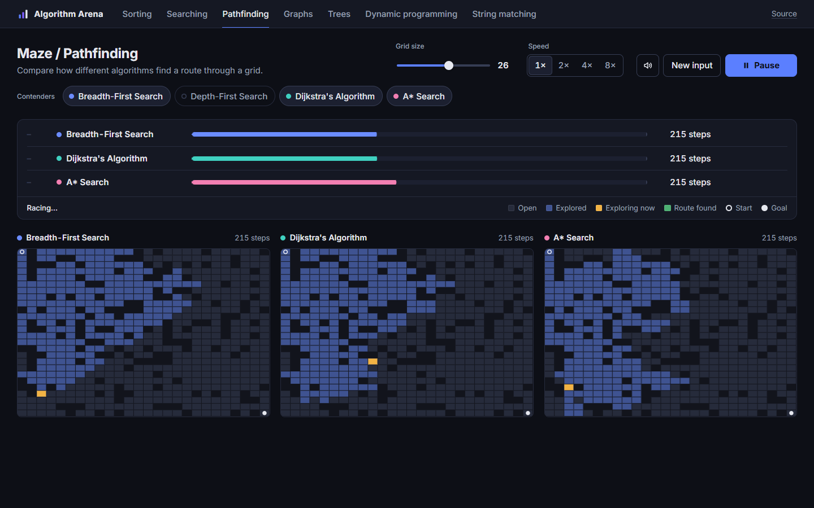

# Algorithm Arena

[](https://github.com/nguyenhanhatminh0105-hue/Algorithm-Visualizer/actions/workflows/ci.yml)

**[Live demo](https://nguyenhanhatminh0105-hue.github.io/Algorithm-Visualizer/)**: runs in the browser, nothing to install.

Algorithm Arena is a website for visually comparing algorithms. Pick a
category, choose how hard the underlying problem should be, add two or more
algorithms as contenders, and watch them race against each other on the same
problem instance.



## How a race reads

- **Scoreboard.** Each contender has a lane that fills as it works towards its
  own finish line. The step count for every contender is worked out before the
  race starts (`js/standings.js`), so the lanes show true progress, not a guess.
- **Result.** Fewest steps wins. The scoreboard gives each finisher a place and
  how far behind the winner it was, and sums the race up in one line, for
  example "Depth-First Search wins in 156 steps, 48% fewer than Breadth-First Search (299)".
- **Controls.** Pick a category from the tabs, toggle contenders on and off,
  set the input size, and change the speed (1× to 8×) while the race runs.
- **Links.** Each category has its own address, such as
  [`#pathfinding`](https://nguyenhanhatminh0105-hue.github.io/Algorithm-Visualizer/#pathfinding).

## Categories

- **Sorting** — Bubble, Selection, Insertion, Quick, and Merge sort racing to
  order the same list.
- **Searching** — Linear vs. Binary search on the same sorted list.
- **Maze / Pathfinding** — BFS, DFS, Dijkstra, and A* finding a route through
  the same grid.
- **Graph Traversal** — BFS vs. DFS exploring the same random graph.
- **Tree Traversal** — Preorder, Inorder, Postorder, and Level Order visiting
  the same binary tree.
- **Dynamic Programming** — Bottom-up tabulation vs. top-down memoization
  solving the same longest-common-subsequence problem.
- **String Matching** — Naive search vs. Knuth-Morris-Pratt finding the same
  pattern in the same text.

Each category has a size control (list size, grid size, node count, string
length, and so on) that regenerates the underlying problem. Any two or more of
its algorithms can race at once, always on the same input.

## Running locally

Requires Node.js 18 or later.

```
npm start
```

Then open http://localhost:3000 in a browser.

### Running tests

```
npm test
```

## Project structure

```
server.js                 minimal static file server (no dependencies)
public/index.html         page layout
public/style.css          styling
public/js/main.js         UI wiring: tabs, contenders, scoreboard, run loop
public/js/engine.js       step-by-step playback engine shared by all categories
public/js/standings.js    scoreboard maths: step counts, places, the result line
public/js/reveal.js       the finish animation for each category
public/js/categories.js   category definitions (algorithms, problem setup, rendering)
public/js/render.js       canvas rendering for each visualization type
public/js/algorithms/     algorithm implementations, grouped by category
```
